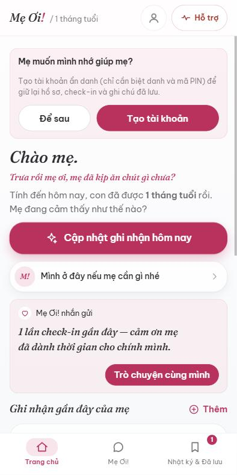
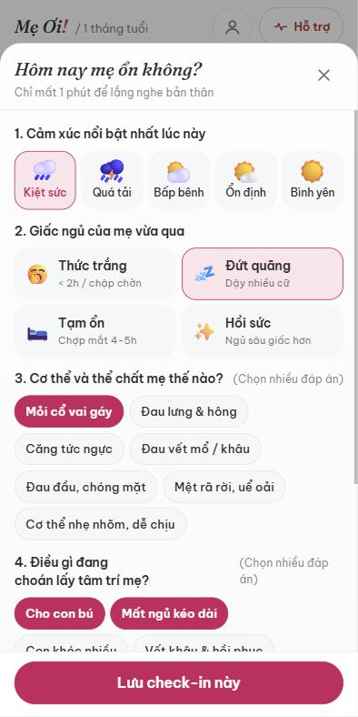
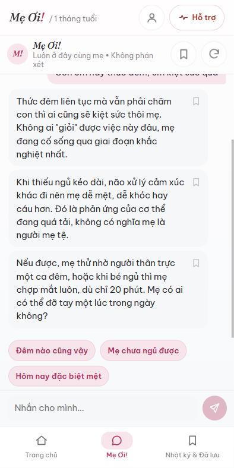
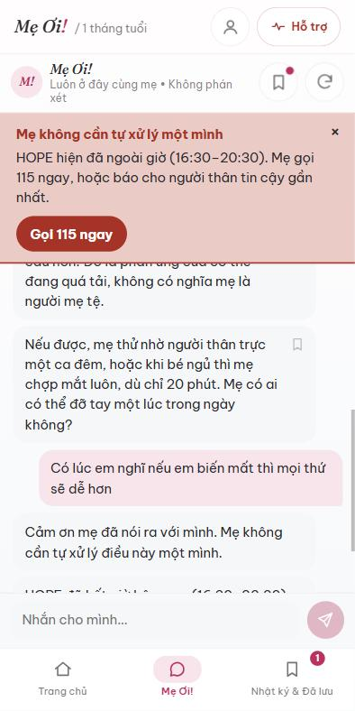
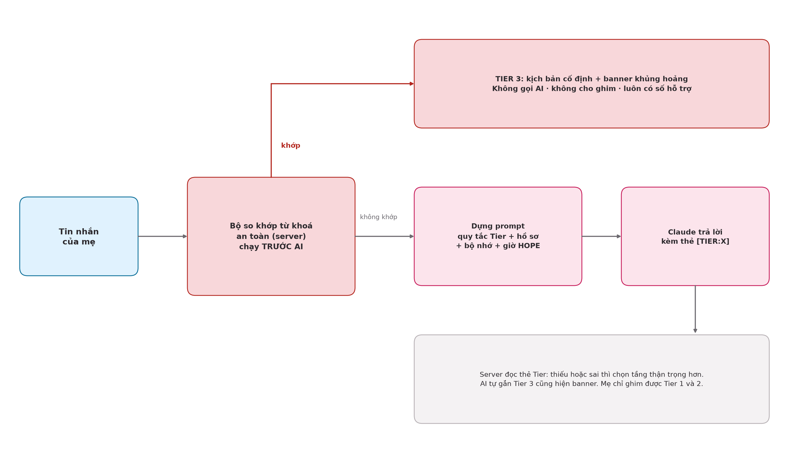
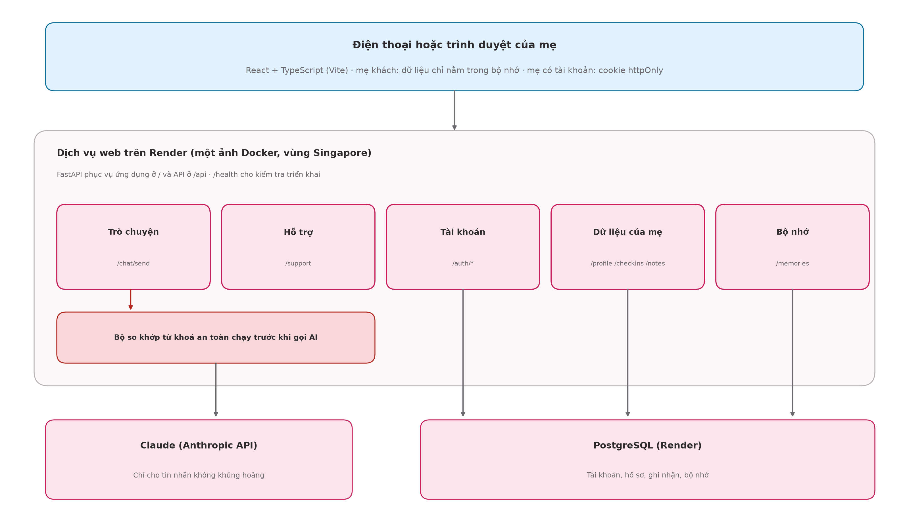
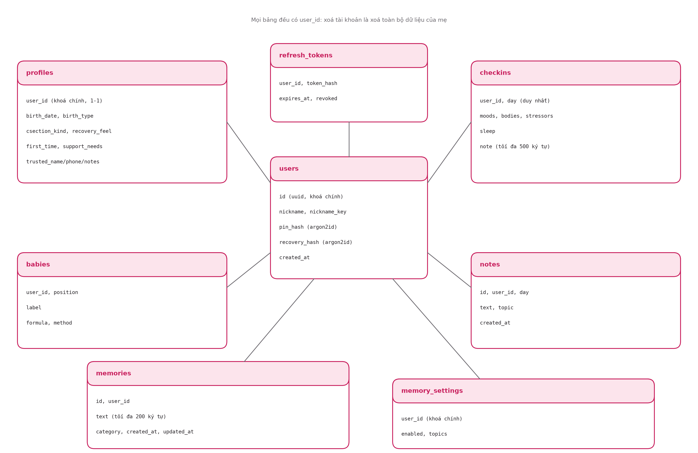

# MeOi! ("Mẹ ơi!")

**An AI companion in Vietnamese for first-time mothers after birth.** Capstone project (đồ án chuyên ngành), Pacific University, Faculty of IT & Semiconductors, by Nguyễn Ngọc Khánh Vân (CNTT22DH1), supervised by TS. Nguyễn Trùng Lập.

- **Live app:** https://meoi.onrender.com (free hosting: if it has been idle, the first load can take about a minute)
- **Health check:** https://meoi.onrender.com/health

> **Tóm tắt (tiếng Việt).** Mẹ Ơi! là người bạn đồng hành bằng tiếng Việt cho mẹ lần đầu sinh con: ghi nhận cảm xúc mỗi ngày, trò chuyện với AI hiểu hoàn cảnh của mẹ, lưu lại lời khuyên, và một tầng an toàn chạy trên máy chủ để mẹ luôn thấy số hỗ trợ khi gặp khủng hoảng. Mẹ ở trung tâm, bé là chủ đề để hỗ trợ mẹ. Chưa có người dùng thật và chưa có chuyên gia y tế duyệt nội dung; xem mục [Status and limits](#status-and-limits).

## What it does

| Screen | What the mother gets |
|---|---|
| Onboarding (5 steps) | Birth experience, recovery feeling, baby's date (age card with a short phase note), feeding, what help she needs most |
| Home | Time-aware greeting, one-tap "Ghi nhận cảm xúc", recent entries, a gentle message from Mẹ Ơi! |
| Ghi nhận (check-in sheet) | Mood, sleep, body, worries and a private note, in about a minute |
| Mẹ Ơi! (chat) | Direct, warm replies that know her profile; save a single reply with one tap; quick replies |
| Nhật ký & Đã lưu | 7-day summary and filters, day cards, saved tips with automatic categories and search |
| Hỗ trợ | Always-one-tap list of numbers (115, HOPE with live opening status, 111, CSAGA, Ngôi nhà Bình yên) |
| Bộ nhớ của mẹ | Mẹ Ơi! proposes short facts ("Mẹ kể rằng…"); she confirms, edits or deletes; six topics with switches |
| Cài đặt & Hồ sơ | Feeding settings, a locked birth profile that she can correct on purpose, account, log out, delete account |

Guests can use the app without an account (nothing is stored on the server). An account is a nickname and a 6-digit PIN with a one-time recovery code: no email, no phone.

<p>




</p>

## Safety design (Tier 3 is infrastructure, not a feature)

1. A server-side keyword matcher runs on **every** message **before** any AI call, so it works even if the client is modified.
2. A Tier 3 message (physical, psychiatric or safety danger) gets a **fixed script and a crisis banner**; the AI is not called, the reply cannot be saved, and the support numbers are always shown.
3. The model appends `[TIER:X]` to each reply; the server parses it and, if it is missing or malformed, chooses the more cautious tier.
4. Hotline hours are computed on the server in `Asia/Ho_Chi_Minh`. HOPE is open daily 16:30-20:30; outside hours the app tells the mother to call 115 and never implies 24/7 support.
5. Logs never contain message text or memory text. The product never diagnoses.



## Architecture

One Docker image on Render serves the React app at `/` and the FastAPI API at `/api`; PostgreSQL holds accounts and what the mother chooses to keep. The chat transcript is **never** stored.



| Part | Technology |
|---|---|
| Frontend | React 18, TypeScript, Vite, hand-written CSS (mobile first, phone frame on large screens) |
| Backend | FastAPI (Python 3.12), SQLAlchemy 2, Alembic, argon2-cffi, PyJWT |
| Database | PostgreSQL (SQLite in unit tests) |
| AI | Anthropic API, called only from the backend; model name from `ANTHROPIC_MODEL` |
| Hosting | Render (free web service, Singapore, free PostgreSQL), `render.yaml` blueprint |
| CI/CD | GitHub Actions (`ci.yml`, `deploy.yml`, `evals.yml`, `ship-lane-a.yml`) |

### API (under `/api`)

| Area | Endpoints |
|---|---|
| Chat and support | `POST /chat/send` (stateless, last 20 messages), `GET /support`, `GET /health` (also at `/`) |
| Account | `POST /auth/register`, `/auth/login`, `/auth/logout`, `/auth/refresh`, `/auth/reset-pin`, `GET /auth/me`, `DELETE /account` |
| Her data | `GET/PUT /profile`, `GET /checkins`, `PUT /checkins/{day}`, `GET/POST /notes`, `DELETE /notes/{id}` |
| Memory | `GET/POST/DELETE /memories`, `PATCH/DELETE /memories/{id}`, `GET/PUT /memories/settings`, `POST /memories/suggest` |

Interactive docs are available from the API service in local development at `http://localhost:8000/docs`.

### Data model



## Repository layout

```
backend/                FastAPI app (app/), Alembic migrations (migrations/), tests (tests/), tier evals (evals/)
frontend/               React + TypeScript app (src/screens, src/components, src/lib), Vitest tests
docs/adr/               Architecture decision records 001-007 (stack, safety keywords, ports, CI, hosting, accounts, memory)
docs/defense/           Defense pack: demo script, screenshots, diagrams, slides
docs/report/            Written report
docs/process/           How changes are made (lanes A/B/C, weekly rhythm, gates)
docs/vi-style-guide.md  Vietnamese wording rules for everything a mother reads
docs/system-prompt-v3.md, docs/content-framework-v3.md, docs/scope-doc-v3.md   Prompt spec, content bank, scope
scripts/                compose-smoke.sh (stack smoke test), lane-check.sh (UI-only change guard)
.github/workflows/      CI, deploy verification, tier evals, UI auto-ship
.claude/skills/ship/    The "/ship" flow for turning a short request into a tested change
render.yaml, Dockerfile Production deployment (one image)
```

## Run it locally

Requirements: Docker Desktop.

```bash
cp .env.example .env            # fill ANTHROPIC_API_KEY, ANTHROPIC_MODEL, JWT_SECRET (never commit .env)
docker compose up --build       # web on http://localhost:8080, api on http://localhost:8000
bash scripts/compose-smoke.sh   # quick check of a running stack (works without an AI key)
```

| Variable | Purpose |
|---|---|
| `ANTHROPIC_API_KEY`, `ANTHROPIC_MODEL` | AI access and model name (never hard-coded). Without them, chat answers with a clean error; the Tier 3 path still works |
| `JWT_SECRET` | Signs login sessions (32+ random characters) |
| `DATABASE_URL` | Set by compose/Render; without it, accounts answer 503 and guests are unaffected |
| `POSTGRES_USER`, `POSTGRES_PASSWORD`, `POSTGRES_DB` | Local compose database |
| `COOKIE_SECURE` | `0` for plain-http local runs (compose sets it) |

Without Docker: `cd backend && pip install -e ".[dev]" && uvicorn app.main:app --port 8000` and `cd frontend && npm ci && npm run dev` (Vite proxies `/api` to port 8000).

## Tests and CI

| Where | Command |
|---|---|
| `backend/` | `pip install -e ".[dev]"`, then `ruff check app tests evals`, `ruff format --check app tests evals`, `mypy app tests evals`, `pytest -q` |
| `frontend/` | `npm ci`, then `npm run lint`, `npm test`, `npm run build` |

Current numbers: **234 backend tests** (plus 15 expected-failure tests that document known keyword gaps) and **64 frontend tests**. Every test uses a mocked AI client, so CI needs no secret and costs nothing; accounts are also tested against a real PostgreSQL service in CI.

- `ci.yml` (every pull request and push to `main`): backend and frontend checks, builds the images, starts the compose stack, signs up and deletes a test account against Postgres, and smoke-tests the production image.
- `deploy.yml`: after CI passes on `main`, Render deploys (`autoDeployTrigger: checksPass`); this workflow waits for the new commit on `/health` and smoke-tests the public site (needs the repository variable `PUBLIC_URL`).
- `evals.yml` (manual): runs the tier test cases on the real model and uploads the reports for a human to grade. Not part of CI (costs money, not deterministic).
- `ship-lane-a.yml`: a `ui/*` branch with only plain UI files merges itself when CI is green (kill switch: repository variable `AUTO_SHIP=off`; frozen during the defense window).

## Deploying

Render reads `render.yaml`: one Docker web service plus a free PostgreSQL database; `JWT_SECRET` is generated by Render; you enter `ANTHROPIC_API_KEY` once in the Render dashboard. Alembic migrations run automatically before the app starts (a failed migration stops the deploy and the previous version keeps serving). Step-by-step guide in Vietnamese: `docs/deploy-render.md`. Free Render databases are deleted 30 days after creation: upgrade or move the database before then (see `docs/adr/006-accounts-and-database.md`).

## How changes are made

Every change goes through a pull request and CI. Changes are sorted into three lanes by risk (look and feel, behaviour, safety and content); safety and content changes need the owner's review and the tier evals. See `docs/process/quy-trinh-cai-tien.md`. Vietnamese wording is governed by `docs/vi-style-guide.md`. Decisions and trade-offs are recorded as ADRs in `docs/adr/`.

## Status and limits

- **Built and running:** everything in "What it does", CI/CD, accounts, database, memory.
- **Not done, so not claimed:** no beta with real mothers (no result about usefulness yet); no medical or psychology reviewer for content (the age-phase sentences, the medical warning box and the three money/work entries are drafts); the legal question of storing health-related data of Vietnamese users is not researched (no compliance is claimed).
- **Evaluation:** seven scenarios plus one variant were run on 2026-10-30 on the first prompt and judged passing by the owner. Later prompt changes (direct replies, profile context, memory) have test cases 8-10 prepared and **not yet graded**.
- **Known gaps:** 15 dangerous phrasings are not caught by the keyword layer yet (listed in `backend/tests/data/safety_golden.json`, awaiting the owner's approval); automatic categories for saved tips are keyword heuristics; free hosting sleeps after 15 minutes of inactivity.
- **Legacy prototype:** `src/meoi-prototype.jsx` (v5) and `docs/prototype/Meoi_v28.html` are references only; the production app is `backend/` + `frontend/`.
